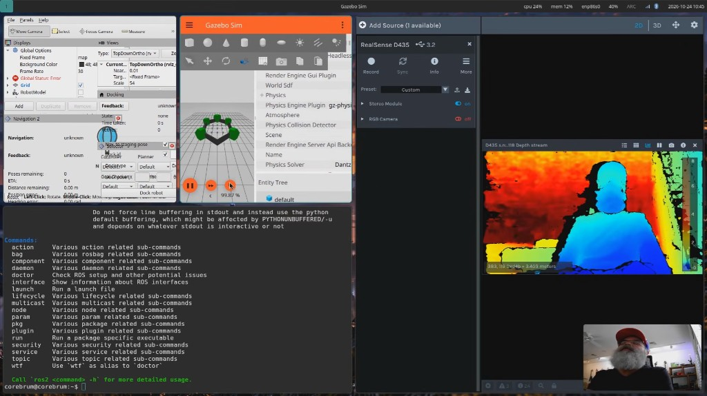

# Corebrum OS

The operating environment for Physical AI. Corebrum OS runs on Ubuntu Server 24.04 LTS and 26.04 LTS, on x86-64 and on ARM64 (aarch64), including Raspberry Pi. It is not a new kernel or a new package manager. Other Ubuntu releases are not supported.

The desktop design was inspired by Omarchy: a keyboard-first tiling session and an app grid. Robotics tools such as ROS 2 (Zenoh RMW), RViz, Gazebo, and AgenticROS are tiles in that grid. Quickshell is not in these Ubuntu archives, so the session uses Sway, Waybar, Fuzzel, and `corebrum-grid`. Sway comes from the Ubuntu archive. ROS 2 is Jazzy on Ubuntu 24.04 and Lyrical Luth on Ubuntu 26.04. Ubuntu 24.04 locks with swaylock. Ubuntu 26.04 locks with gtklock.

AI Agents are built into the OS. [AgenticROS](https://agenticros.com) gives those agents full control over their own ROS-powered bodies, including eyes, wheels, legs, arms, propellers, and more.

Original Corebrum code in this repository is under the MIT license in `LICENSE`. Third-party components keep their own licenses. The MIT choice is subject to license review.

## Demo

[](https://www.youtube.com/watch?v=a010iQF9h7g)

[Meet Corebrum](https://www.youtube.com/watch?v=a010iQF9h7g) walks through the desktop with ROS 2, Gazebo, RealSense, and the built-in AI agents.

## Current status

Supported hosts are Ubuntu Server 24.04 and 26.04 on x86-64 and ARM64. On 2026-10-28 the install and the running system were confirmed on both releases. The desktop, ROS 2, RealSense, AgenticROS, and the AI agents run on both, including a Raspberry Pi. Ubuntu 24.04 installs ROS 2 Jazzy and locks with swaylock. Ubuntu 26.04 installs ROS 2 Lyrical and locks with gtklock. The phase record is in `COREBRUM_BUILD_PLAN.md`. Other Ubuntu releases are rejected before any package is installed. See `docs/decisions/0088-ubuntu-2404.md`.

## Install

A fresh server does not have this repository yet:

```bash
sudo apt update
sudo apt install -y git ca-certificates
git clone https://github.com/Corebrum/corebrum-os.git
cd corebrum-os
sudo ./scripts/install.sh --profile desktop
```

`--profile desktop` installs the base profile first, then the Sway session and workstation services. You do not need to run `--profile base` before it.

After the `corebrum` command exists, the same install is `sudo corebrum install desktop`.

Reboot when that finishes. The login screen is on VT 7 (`Ctrl+Alt+F7`). VT 1 (`Ctrl+Alt+F1`) stays a text console. The steps are in `docs/installation/desktop.md`.

Add `--enable-ssh` on that same command if you want OpenSSH enabled during the install:

```bash
sudo ./scripts/install.sh --profile desktop --enable-ssh
```

The Cursor agent install, `agent login`, and a `PATH` line in `~/.bashrc` stay on your account. The installer does not write a home directory and does not install Cursor. The editor in the base profile is `nano`.

### Updates

Super+Space **Updates** upgrades Ubuntu, this checkout, ROS 2, Zenoh, AgenticROS, and the AI agents already installed. **All** runs those six steps in order. A login reminder once a week points at that menu and does not apply upgrades. The row-by-row commands are in `docs/installation/desktop.md` and `docs/decisions/0045-software-updates.md`.

### Headless server

The base profile is the Ubuntu Server foundation. It runs `apt-get update` and installs `curl`, `ca-certificates`, `tmux`, and `nano`. `--enable-ssh` installs OpenSSH and enables the `ssh` service. `hostname -I` prints an address you can connect to.

```bash
sudo ./scripts/install.sh --profile base --enable-ssh
hostname -I
```

## Preview the base install

On Ubuntu Server 24.04 or 26.04, x86-64 or ARM64:

```bash
./scripts/install.sh --profile base --dry-run
```

`--dry-run` prints the intended actions. It does not install packages, enable services, or write `/etc` or `/var`.

Apply it only on a machine you intend to turn into a Corebrum base system:

```bash
sudo ./scripts/install.sh --profile base
sudo ./scripts/validate/base.sh
```

OpenSSH is opt-in:

```bash
sudo ./scripts/install.sh --profile base --enable-ssh
```

## Preview the desktop install

```bash
./scripts/install.sh --profile desktop --dry-run
```

`--dry-run` prints the desktop actions. It does not install packages or write configuration. The install command is in [Install](#install) above.

## Checks

```bash
make check
```

`make check` runs ShellCheck, unit tests, and dry-runs of the base and desktop profiles. Development requirements are in `docs/development/requirements.md`.
